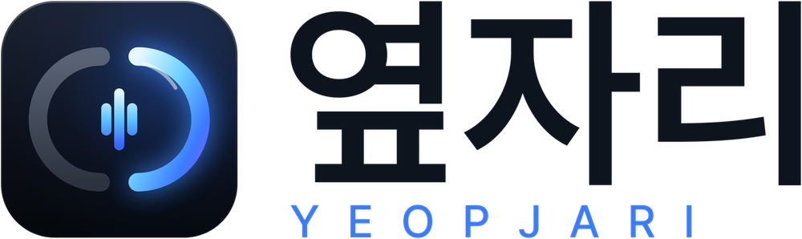
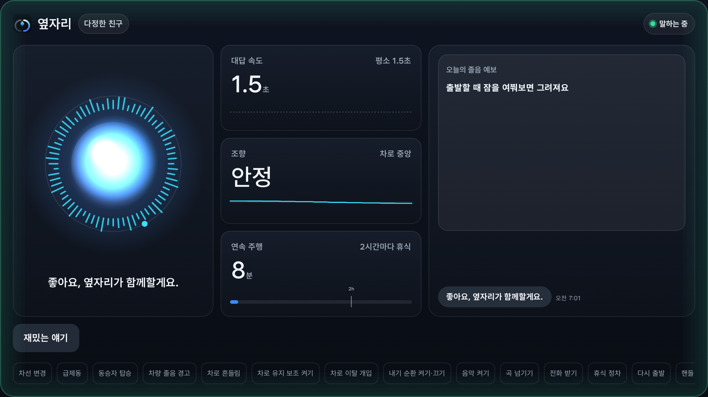

<p align="center">
  <picture>
    <source media="(prefers-color-scheme: dark)" srcset="docs/logo_dark.png">
    
  </picture>
</p>

<p align="center"><b>졸음을 경고하는 앱이 아니라, 졸음이 오기 전에 말을 걸고 쉬는 것까지 챙기는 차량용 음성 동승자</b></p>

<p align="center">Pleos Connect 앱 · Android (Kotlin, Jetpack Compose) · 현대자동차그룹 차량용 앱 개발 공모전 출품작</p>

<p align="center">▶ <a href="https://youtu.be/pqLPt3M1N_U"><b>시연 영상 보기</b></a> (4분 50초 · 영어 자막 · 장마다 챕터) &nbsp;·&nbsp; 📦 <a href="apk/Yeopjari_release.apk"><b>APK 받기</b></a></p>

## 한눈에

- **출발 전 졸음 예보** — 어젯밤 잠과 지금 시각으로 이번 주행의 졸음을 미리 그리고(세 과정 각성 모형), 위험해지기 전에 쉴 때를 약속합니다.
- **대답 속도로 각성 확인** — 바쁜 순간(차선 변경·급제동)은 피해 가볍게 말을 걸고, 운전자 본인의 평소 대답 속도와 비교해 정상 → 주의(환기) → 위험(깨우기)으로 판단합니다.
- **쉬는 것까지** — 위험하면 진행 방향 앞쪽의 휴게소·졸음쉼터(공공데이터 실제 파일)를 경유지로 넣고, 커피 냅과 15분 파워냅(좌석·환기·알람), 가족 문자까지 챙깁니다.
- **기억하는 동승자** — 목소리 4종. "커피 좋아해", "호두과자" 같은 대화를 기억했다가 쉬는 순간에 꺼냅니다. 질문을 기다리지 않고 **말하기**로 언제든 먼저 말할 수 있습니다.
- **차와 연결** — 차량 신호·제어를 Pleos Vehicle · NaviHelper · FusedLocation SDK 에 연결했습니다(아래 활용 지도).
- **검증** — 판단 로직 단위 테스트 144개, 앱 자동 테스트 35개(시연 앱 30개는 Robolectric으로 Android 15 환경에서 실행), 정적 분석(lint) 오류 0. 판단은 설명 가능한 규칙과 공개 연구의 모형으로 하며, 생성형 AI 대화는 다음 단계입니다.

<p align="center"></p>

> 옆자리는 각성 유지를 돕는 보조 서비스이며 의료적 진단을 하지 않습니다. 시연 영상(https://youtu.be/pqLPt3M1N_U) 속 시각·경로·운전자는 시연용 이야기입니다.

## 심사위원용 빠른 시작 (약 3분)

1. **설치** — `apk/Yeopjari_release.apk` 를 Android 에뮬레이터(API 28 이상, 권장: Pixel Tablet · API 35 · Google Play 이미지)나 휴대폰에 끌어다 놓거나 `adb install apk/Yeopjari_release.apk`.
2. **열기** — "옆자리"를 열고 마이크 권한을 허용합니다. 약 5초 뒤 가상 고속도로 주행(실제 1초 = 가상 1분)과 함께 동행이 시작됩니다. 바로 보려면 **같이 가기**.
   - 가로 화면에서 영상과 같은 세 칸 배치가 됩니다(에뮬레이터는 가로로 돌리거나 태블릿 AVD 권장).
   - 시연 빌드는 기다리지 않도록 시간을 줄였습니다: 20초마다 말을 걸고, 파워냅 15초(실제 15분), "조용히 해 줘" 1분(새벽·장시간 운전 30초 · 실제 20분/10분), 정차 10초면 휴식 인정(실제 10분).
   - **에뮬레이터에서 목소리로 대답하려면** 에뮬레이터의 **⋯ (Extended controls) → Microphone → "Virtual microphone uses host audio input"** 을 켜고, Google 앱(음성 인식)과 한국어 TTS 가 있는 이미지(Google APIs/Play)를 쓰세요. 안 되는 항목은 앱 위에 노란 안내로 뜹니다.
3. **시연** — 말을 걸면 소리 내어 짧게 대답합니다. 마이크가 안 되면 듣는 동안 뜨는 **빠른 대답**을 눌러도 같은 흐름으로 이어지고, 한 번 화면으로 대답한 뒤에는 누르지 않고 두면 무응답으로 봅니다. 질문을 기다리지 않고 **말하기**를 누르거나 입력칸에 "조용히 해 줘"·"피곤해"를 써도 바로 따릅니다. 아래 버튼으로 전체 흐름을 확인할 수 있습니다.
   - 바쁜 순간: **차선 변경** · **급제동** → 말을 멈추고 기다림
   - 졸음: 일부러 늦게 대답하거나 대답하지 않기 → **주의**(환기) → **위험**(열혈 교관 · 알람 · 휴게소 경유지)
   - 쉬는 것까지: **휴식 정차** → 파워냅 제안 → "응" → 커피 질문에 대답 → 15초 파워냅 → **다시 출발** (낮잠 중에 출발하면 바로 멈추고, 좌석은 다음 정차 때 세웁니다)
   - 먼저 말하기: **말하기**를 누르고 "조용히 해 줘"·"피곤해"·"재밌는 얘기 해 줘" (입력칸에 써도 됨)
   - 그 밖에: **내기 순환 켜기·끄기**(30초 뒤 외기로 전환) · **차로 유지 보조 켜기** · **차로 이탈 개입** · **핸들 놓음 경고** · **카메라 졸음 경고** · **차량 졸음 경고** · **동승자 탑승** · **음악 켜기** · **전화 받기** · "재밌는 얘기 해 줘"

## Pleos Connect SDK 활용 지도

차와 닿는 부분은 모두 작은 인터페이스(포트, [`Ports.kt`](app/src/main/java/ai/yeopjari/app/ports/Ports.kt))로 나눴습니다. 시연 빌드는 이 포트를 가상 주행으로, Pleos 빌드는 Pleos SDK 로 채웁니다. 판단 엔진(`core/`)은 어느 쪽인지 모릅니다.

| Pleos SDK | 쓰는 값 · 기능 | 옆자리에서 하는 일 | 포트 → Pleos 구현 |
|---|---|---|---|
| **Vehicle** + Android Automotive `GEAR_SELECTION` + **FusedLocation** | 기어 P/R/N/D(SDK 2.3.2 안내대로 표준 차량 속성을 먼저 읽고, 못 읽는 기기에서만 Pleos 기어 API), 위치 변화로 계산한 차속 | 동행 시작(고속 주행 누적), 정차·휴식 인정, 파워냅은 P단에서만 | `VehicleSource` ([Ports.kt:11](app/src/main/java/ai/yeopjari/app/ports/Ports.kt#L11)) → `PleosVehicleState` ([PlatformFactory.kt:328](app/src/pleos/java/ai/yeopjari/app/PlatformFactory.kt#L328)) |
| **Vehicle** (TurnSignal · Brake · SteeringWheel) | 방향지시등, 급제동, 조향각 | 바쁜 순간 말 멈춤(`WorkloadGate`), 조향 흔들림 단서(`SteeringMonitor`) | 같은 `VehicleSnapshot` 필드 |
| **Vehicle** (Seat · Safety/ADAS) | 조수석 탑승, 운전자 주의 경고(`DRIVER_ATTENTION`) | 동승자가 타면 대화 양보, 차량 경고 시 바로 위험 단계 | 같은 `VehicleSnapshot` 필드 |
| **Vehicle** (Safety/ADAS 경고등) | 차로 유지 보조 `LKA`·`LFA`, 차로 이탈 보조 개입(`ELK`, `LKA` 깜빡임) | 보조가 켜져 있으면 조향 대신 대답으로 판단, 개입하면 바로 확인 | `isLaneAssistOn` · `isLaneIntervention` ([PlatformFactory.kt:308](app/src/pleos/java/ai/yeopjari/app/PlatformFactory.kt#L308)) |
| **Vehicle** (HVAC 내기 순환) | 내기 순환 켜짐/꺼짐 | 30분(새벽 20분) 넘게 이어지면 외기로 한 번 전환 | `VehicleSnapshot.recirculationOn` → `CabinAirTracker` |
| **Vehicle** (HVAC · Seat · Window · Light) | 외기 유입·온도·풍량, 등받이·통풍, 운전석 창문, 실내등 | 주의 단계 환기, 깨우기(끝나면 창문·온도·풍량·통풍·열선·실내등을 원래대로), 파워냅 좌석 눕히기·되돌리기 | `CabinControl` ([Ports.kt:43](app/src/main/java/ai/yeopjari/app/ports/Ports.kt#L43)) → `PleosCabinControl` ([PlatformFactory.kt:516](app/src/pleos/java/ai/yeopjari/app/PlatformFactory.kt#L516)) |
| **NaviHelper** | 경유지 추가, 남은 거리 | 위험 단계에서 가장 가까운 휴게소를 경유지로, 100km 이상 장거리면 출발 5분 뒤 동행 | `Navigator` ([Ports.kt:23](app/src/main/java/ai/yeopjari/app/ports/Ports.kt#L23)) → `PleosNavigator` ([PlatformFactory.kt:701](app/src/pleos/java/ai/yeopjari/app/PlatformFactory.kt#L701)) |
| **FusedLocation** | 현재 위치, 진행 방향 | 진행 방향 앞쪽의 가장 가까운 휴게소·졸음쉼터 찾기 | `LocationSource` ([Ports.kt:15](app/src/main/java/ai/yeopjari/app/ports/Ports.kt#L15)) → `PleosLocation` ([PlatformFactory.kt:155](app/src/pleos/java/ai/yeopjari/app/PlatformFactory.kt#L155)) — 끊기면 기기 GPS, 터널에서는 D단 동안 마지막 속도 유지 |
| TextToSpeech · SpeechToText | 말하기, 듣기 | 대답 시작까지 걸린 시간 측정(음성 원문은 저장하지 않음), 목소리 4종 | `VoiceIO` ([Ports.kt:73](app/src/main/java/ai/yeopjari/app/ports/Ports.kt#L73)) → `AndroidVoiceIO` (Pleos TTS/STT 로 이 클래스만 교체) |

**현재 상태:** 시연 빌드가 전체 흐름을 실제로 구동합니다(자동 화면 테스트 `AppSmokeTest` 통과, Robolectric으로 Android 15·API 35 환경에서 실행). Pleos 빌드는 Vehicle 2.3.2 · NaviHelper 3.0.5 · FusedLocation 1.1.3 SDK 에 연결된 코드가 컴파일되며, 온도·풍량·통풍·창문은 범위를 먼저 확인하고, 어떤 제어든 실패하면 음성으로 대신 안내합니다. Pleos Connect 에뮬레이터·실차 확인은 다음 단계입니다. 비상등은 Vehicle SDK 에 제어 API 가 없어 운전자에게 음성으로 켜 달라고 요청하고, 핸들 파지 감지·실내 카메라 졸음 경고는 공개 SDK 에 읽기 API 가 없어 판단 로직과 시연 버튼만 준비해 두었습니다.

## APK

| 파일 | 용도 |
|---|---|
| [`apk/Yeopjari_release.apk`](apk/Yeopjari_release.apk) (약 24MB) | **시연 빌드** — 일반 Android 휴대폰·에뮬레이터(API 28 이상)에서 가상 주행으로 전체 흐름 확인. **심사용** |
| [`apk/Yeopjari_pleos_release.apk`](apk/Yeopjari_pleos_release.apk) (약 28MB) | **Pleos 빌드** — Pleos Connect 기기·에뮬레이터 전용, 실제 차량 신호·제어 사용 |

두 파일 모두 공모전 시연용으로 Android 디버그 인증서로 서명했습니다. 배포 시 정식 인증서로 다시 서명합니다.

## 빌드와 실행

| 항목 | 내용 |
|---|---|
| 개발 도구 | Android Studio, JDK 17 이상 |
| Android | minSdk 28, target/compileSdk 35 |
| 빌드 | Gradle 8.10.2 (wrapper), AGP 8.8.2, Kotlin 2.0.0 |
| Pleos SDK | Vehicle 2.3.2 · NaviHelper 3.0.5 · FusedLocation 1.1.3 (`ai.pleos.playground`, `pleos` 빌드만) |
| 권한 | 마이크(대답 확인), 위치(휴식 장소 거리), 문자(가족 알림 · 번호를 등록한 경우만) |

**시연 빌드** (`sim`, Pleos SDK 불필요):

```bash
./gradlew :app:assembleSimRelease
adb install app/build/outputs/apk/sim/release/app-sim-release.apk
```

**Pleos 빌드** (`pleos`): Pleos 전용 저장소에서 SDK 를 받으므로 기본으로 꺼져 있습니다. `gradle.properties` 의 `yeopjari.pleos=false` 를 `true` 로 바꾸고 Gradle Sync 를 다시 하면 생깁니다.

```bash
./gradlew :app:assemblePleosRelease
adb install app/build/outputs/apk/pleos/release/app-pleos-release.apk
```

Pleos 빌드는 동행 전이나 정차 중에 **차량 연결 점검** 화면을 엽니다. 신호(기어·방향지시등·브레이크·조향각·조수석·운전자 주의 경고·차로 유지 보조·차로 이탈 보조 개입·와이퍼·내기 순환·차속·NaviHelper)마다 지금 값과 수신 여부(✓/✗)를, 제어(외기 유입·깨우기·창문·등받이·경유지·남은 거리)마다 시험 버튼과 결과·SDK 오류 문구를 보여 줍니다.

**릴리스 서명:** 루트에 `keystore.properties`(`storeFile`, `storePassword`, `keyAlias`, `keyPassword`)가 있으면 그 키로, 없으면 디버그 키로 서명합니다. 키 파일은 저장소에 올리지 않습니다.

## 테스트

```bash
./gradlew :core:test :app:testSimDebugUnitTest               # 판단 로직 144개 + 시연 앱 30개
./gradlew -Pyeopjari.pleos=true :app:testPleosDebugUnitTest  # Pleos SDK 값 → 앱 신호 옮기기 5개
```

- **판단 로직(`core/`, 144개)** — 각성 판정, 주행 상태, 대화와 기억, 음악·통화 타이밍, 거리 계산, 위치 차속(터널 유지), 차로 유지 보조, 휴식 계획과 졸음 예보, 내기 순환, 커피 냅, 운행 요약, 가족 문자, 실제 휴게소·졸음쉼터 파일 읽기.
- **앱(35개, 시연 앱 30개는 Robolectric으로 Android 15 · API 35 환경에서 실행)** — `AppSmokeTest`(화면 흐름), `ScreenLayoutTest`(5가지 화면 크기 배치와 48dp 터치 영역, 결과 이미지 [`docs/screens/`](docs/screens)), `DialogueFlowTest`(대본대로 빠르게·느리게·대답 없이 답하는 가짜 목소리로 정상 → 주의 → 위험 → 깨우기 → 가족 연락 → 안심 문자, 잠 질문 → 휴식 약속 → 쉼터 → 커피 냅, 낮잠 중 출발 시 취소, 마이크·인식기 오류 시 화면 대답, 질문 없이 먼저 말하기, 휴식 미루기 등), Pleos 신호 변환 5개.

## 기능 자세히

**대화와 판단**
- **말 걸 때를 압니다** — 차선 변경·급제동·큰 회전 중에는 기다렸다가, 여유로울 때 가볍게 말을 겁니다. 바로 답할 수 있는 가벼운 말(대답 속도 측정)과 즐거운 대화(측정 제외)를 번갈아 건넵니다.
- **나와 비교합니다** — 처음 세 번의 대답으로 평소 속도를 정하고, 그보다 느려질 때만 개입합니다. 평소 속도는 저장해 다음 주행에도 이어 쓰므로, 출발부터 피곤한 날도 알아챕니다.
- **조향은 단서로만** — 차로 안에서 흔들렸다 바로잡는 조향이 평소보다 잦으면 경고하지 않고 다음 확인을 앞당겨 대답으로 확인합니다. 차로 유지 보조(LKA·LFA)가 켜져 있으면 조향은 보지 않고, 이탈 보조가 개입하면 바로 확인합니다.
- **운전자가 먼저 말해도** — "피곤해"면 바로 휴식 장소를, "조용히 해 줘"면 20분(새벽·장시간 운전 땐 10분) 동안 먼저 말을 걸지 않습니다. 그동안에도 조향 흔들림과 차량 경고는 계속 보고, 신호가 보이면 돌아와 이유를 말합니다.
- **차량 경고와 함께** — 차량의 운전자 주의 경고가 울리면 대화 결과와 상관없이 바로 위험 단계로 올립니다. 조수석에 동승자가 타면 대화를 멈추고, 쉼터를 권할 때 운전 교대도 함께 권합니다.
- **음악·통화 중에도** — 말할 때는 음악 소리를 줄이고, 들을 때는 잠깐 멈춥니다. 정상 단계에서는 곡 사이까지 기다리고, 통화 중에는 끼어들지 않습니다(위험 단계에서는 20초까지만 기다림).
- **오래 달리면 말놀이** — 쉬지 않고 90분이 넘으면 끝말잇기 같은 짧은 말놀이를 섞습니다(Atchley 외, 2014). 생각할 시간이 필요해 대답 속도 판정에는 쓰지 않습니다.

**졸리기 전에**
- **졸음 예보** — 출발할 때 어젯밤 잠·일어난 시각·지금 시각으로 이번 주행의 졸음(KSS 1~9)을 그리고, 위험(KSS 8 이상)이 시작될 시각을 알려 줍니다. 모형은 각성의 세 과정 모형(Åkerstedt & Folkard 1997), 값은 Ingre 외 2014(PLoS ONE)의 기본값입니다. 같은 모형으로 예측한 졸음이 한 단계 오를 때마다 사고 위험이 1.72배였습니다(Åkerstedt 외 2008). 사람마다 차이가 커서 예보는 출발점이고, 주행 중에는 대답 속도·핸들·차량 경고가 실제 상태를 알려 줍니다([`FatigueForecast.kt`](core/src/main/kotlin/ai/yeopjari/core/FatigueForecast.kt)).
- **쉴 때를 미리 약속** — 잠·시간대·남은 거리로 첫 휴식을 정합니다(기본 2시간, 잠 5~7시간이면 1시간 반, 5시간 미만이면 1시간, 새벽·오후 졸음 시간대면 더 앞당기고, 예보가 있으면 예보한 위험 30분 전까지로 앞당김). 약속 10분 전에 가까운 쉼터를 권하고, "아직 괜찮아"라고 미루면 30분 동안 절반 간격으로 더 자주 확인하고, 30분 운전한 뒤 다시 권합니다.
- **마지막 쉼터 안내** — 한 시간 넘게 달린 뒤, 다음 쉼터를 지나면 40km 넘게 쉴 곳이 없을 때 미리 알리고 들를지 묻습니다.
- **환기 습관** — 내기 순환이 30분(새벽 20분) 넘게 이어지면 바깥 공기로 한 번 바꿉니다(실내 이산화탄소 누적, 졸음 판정과는 별개).

**깨우고 쉬게 하기**
- **주의** — 외기 유입과 운전석 창문 2~3cm(비 올 때 제외). 창문·찬 바람은 쉬러 가기까지의 다리일 뿐 졸음을 없애 주지 않는다고 솔직하게 말합니다(Reyner & Horne, 1998).
- **위험** — 다시 불러도 대답이 없는 확인이 두 번 이어지면(두 번째 확인은 45초 뒤) 열혈 교관 목소리·알람·찬 바람·통풍 시트·실내등으로 깨우고, 대답하면 가장 가까운 쉼터를 경유지로 넣습니다. 계속 무응답이면 비상등을 켜 달라고 하고 정차를 안내합니다. 브레이크·조향·경적은 쓰지 않습니다.
- **커피 냅** — 쉼터에서 원하면 커피를 마시고 바로 15분 자도록 권합니다(Reyner & Horne, 1997). 커피를 좋아한다고 했으면 그 기억을 꺼내고, 그 휴게소에 커피 전문점이 공공데이터에 있으면 이름도 말합니다("여기 까페베네 있어요"). 주문·결제는 하지 않습니다(Pleos Connect 에 결제 API 없음).
- **파워냅** — P단에서 좌석을 눕히고 환기한 뒤, 대답할 때까지 알람을 세 번까지 울려 깨우고 좌석을 세웁니다. 낮잠 중에 출발하면 바로 멈추고 좌석은 다음 정차 때 세웁니다. 커피를 사러 간 동안 대답이 없으면 빈 차에서 낮잠을 시작하지 않습니다.
- **가족 알림** — 정차 중 등록한 번호로 파워냅 시작·재출발 때 문자를 보내고, 깨워도 대답이 없는 위급한 때에만 한 번 더(30분에 한 번까지), 다시 대답하면 안심 문자를 보냅니다. 위치는 휴게소 이름까지만 적고, 통신사 전송 결과(RESULT_OK)를 받았을 때만 "보냈다"고 기록합니다.

**동승자다움**
- **목소리 4종** — 다정한 친구·경상도 아재·열혈 교관·장난꾸러기. 대답이 없을 때 첫 깨우기는 언제나 열혈 교관입니다.
- **기억** — 응원하는 팀·좋아하는 간식·커피 같은 대화를 기억해 다음 대화와 다음 주행에 꺼냅니다. "재밌는 얘기 해 줘"에는 짧은 이야기로 답합니다.
- **오늘의 운행** — 함께한 시간·대화 수·대답 속도·졸음 신호·깨우기·휴식·기억을 정리해 정차하거나 동행이 끝나면 보여 줍니다.
- **목소리가 안 될 때도** — 듣는 동안 빠른 대답("응", "응, 괜찮아", "피곤해", "조용히 해 줘", "재밌는 얘기 해 줘", "어, 해 봐")과 입력칸이 함께 뜨고, 목소리와 같은 길로 들어갑니다(대답 속도도 같이 잼). 마이크·음성 인식·한국어 TTS 가 없으면 고칠 방법을 화면에 띄우고, 목소리를 한 번도 알아듣지 못했으면 무응답을 졸음으로 판정하지 않습니다.
- **질문을 기다리지 않고 먼저 말하기** — 동행 중에는 화면에 **말하기** 버튼과 입력칸이 늘 있습니다. 누르고 "조용히 해 줘", "피곤해", "재밌는 얘기 해 줘"라고 하거나 입력하면 바로 따릅니다(차에서는 핸들의 음성 버튼에 연결).
- **화면** — Pleos 분할 화면의 앱 창에 맞춘 짙은 유리 패널. 넓은 창에서는 세 칸(AI 오브·자막 / 대답 속도·조향·연속 주행 / 졸음 예보·대화), 세로나 좁은 창에서는 한 줄로 쌓고, 창 크기에 맞춰 0.7~3배로 키웁니다. 경고는 큰 상자 대신 오브와 테두리 빛으로 올라가고, 판단 근거("대답 2.8초 · 평소의 2.3배")를 칩으로 보여 줍니다. 버튼 터치 영역은 48dp 이상입니다.
- **시작은 상황에 맞게** — 고속 주행 30분(새벽·오후 졸음 시간대 15분) 누적, 목적지 100km 이상이면 출발 5분 뒤, **같이 가기**나 차량 졸음 경고로는 바로 시작합니다.

## 구조

```text
core/   순수 Kotlin 판단 로직 (Android 의존 없음, 단위 테스트 144개)
  AlertnessEngine      대답 지연·대답 여부를 본인 기준선과 비교해 정상/주의/위험 판정
  WorkloadGate         차선 변경·급제동·큰 조향 중에는 말을 걸지 않음
  DriverIntent         "피곤해"·"조용히 해 줘"·"재밌는 얘기 해 줘" 같은 요청 읽기
  QuietMode            조용히 모드: 말은 멈추고 감지는 계속
  Conversation         측정용 말과 대화용 말, 맞장구, 이야기, 운전자 기억
  TalkPolicy           음악·통화 중 언제 말할지, 음악 줄이기/멈추기
  SteeringMonitor      평소 대비 조향 흔들림(확인을 앞당기는 단서)
  LaneAssist           차로 유지 보조 켜짐/이탈 보조 개입 처리
  FatigueForecast      세 과정 각성 모형으로 주행 중 KSS 예측
  RestPlan             잠·시간대·남은 거리·예보로 첫 휴식 시점
  CoffeeNap            커피 냅 권유(기억·입점 브랜드 반영)
  CabinAir             내기 순환이 오래 이어지면 외기 전환
  DriveSessionTracker  동행 시작·휴식 인정
  RestStops · RestStopCsv · Destinations · ServiceAreaBrands
                       공공데이터 휴게소·졸음쉼터 읽기, 진행 방향 판별, 입점 브랜드
  TripReport · FamilyNotice · GpsSpeed · Persona · QuestionBank · Replies
app/    Android 앱 (Jetpack Compose)
  CopilotViewModel     차량 상태 → 대화 → 단계별 개입 → 휴식 → 재출발 흐름
  ports/Ports.kt       차량·위치·내비·실내 제어·음성 인터페이스
  voice/               Android TTS·음성 인식·오디오 포커스, 음악·통화 상태
  src/sim              가상 주행·시연 조작
  src/pleos            Pleos SDK 연동, 차량 연결 점검 화면
```

## 개발 현황

| 영역 | 상태 |
|---|---|
| 판단 로직 전체(각성 판정·졸음 예보·휴식 계획·조용히 모드·대화와 기억·음악/통화 타이밍 등) | 완료 · 단위 테스트 144개 |
| 시연 빌드 전체 흐름(주의 → 위험 → 깨우기 → 휴식 → 재출발, 커피 냅, 가족 문자) | 완료 · 앱 자동 테스트 30개 |
| Pleos 차량 신호·제어, NaviHelper 경유지, FusedLocation | 코드 연결·빌드 완료 · Pleos 에뮬레이터 확인 전 |
| 곡 남은 시간·곡 넘기기·곡 제목(실차) | Pleos 미디어 정보 연결 전 — 지금은 곡 사이를 기다리지 않고 소리만 줄임 |
| 생성형 AI 대화 | 다음 단계 — 측정용 말은 그대로 두고 대화용 말만 생성 |
| 갈림길 인식(NaviHelper), 차로 이탈 경고 결합 | 다음 단계 |

## 데이터 출처

`app/src/main/assets/` 에 공공데이터포털(한국도로공사) 원본 파일을 그대로 넣었습니다.

| 파일 | 원본 | 기준일 | 건수 |
|---|---|---|---|
| `service_areas.csv` | [전국휴게소정보표준데이터](https://www.data.go.kr/data/15025446/standard.do) | 2026-09-17 | 215곳 |
| `drowsy_shelters.csv` | [전국졸음쉼터표준데이터](https://www.data.go.kr/data/15028203/standard.do) | 2026-02-25 | 253곳 |
| `service_area_brands.csv` | [한국도로공사_노선별 방향별 휴게소 편의시설 현황(LOD)](https://www.data.go.kr/data/15043721/fileData.do) | 2025-07-08 | 168줄 |

- 데이터에 적힌 행선지로 어느 쪽 차로의 쉼터인지 판별해, 맞은편 차로 쉼터는 권하지 않습니다([`Destinations.kt`](core/src/main/kotlin/ai/yeopjari/core/Destinations.kt)).
- 입점 브랜드는 짝이 확실한 휴게소에만 붙입니다(215곳 중 144곳, 커피 전문점 43곳). 확실하지 않으면 가게 이름을 말하지 않습니다([`ServiceAreaBrands.kt`](core/src/main/kotlin/ai/yeopjari/core/ServiceAreaBrands.kt)).
- `RealRestStopDataTest` 가 실제 파일을 그대로 읽어 확인합니다(빠진 줄 0). 자동 대화 테스트는 결과를 고정하려고 `rest_stops.json` 의 샘플 4곳만 씁니다.

## 라이선스 · 크레딧

- 글꼴: [Wanted Sans](https://github.com/wanteddev/wanted-sans)(본문), [Pretendard](https://github.com/orioncactus/pretendard)(로고 글자) — 모두 SIL Open Font License 1.1. 라이선스 전문: [`app/src/main/assets/licenses/`](app/src/main/assets/licenses)
- 휴게소·졸음쉼터 데이터: 공공데이터포털(한국도로공사)
- 연구: Drews, Pasupathi & Strayer 2008, Åkerstedt & Folkard 1997, Ingre 외 2014, Åkerstedt 외 2008, Reyner & Horne 1997·1998, Atchley 외 2014

---

옆자리 · 현대자동차그룹 차량용 앱 개발 공모전 출품작
